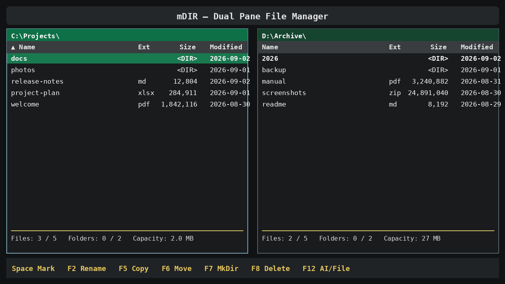

## 2.26.44: F9 Zip/Unzip and direct Windows drive letters

**F9 Zip/Unzip** compresses selected files and folders into a ZIP in the opposite pane. With a single selected `.zip`, F9 extracts it into the opposite pane using the existing secure archive dialogs, with progress, cancel and overwrite checks. `Alt+F5` and `Alt+F6` remain separate archive shortcuts. RAR, 7z and TAR extraction are not yet supported by the built-in ZIP engine.

The location selector formerly on F9 is now **Alt+F9** (alongside existing Alt+F1/Alt+F2 pane location pickers). On **Windows** the Alt+letter shortcuts (e.g. Alt+C, Alt+D, Alt+S) change the active pane's drive immediately. On **Ubuntu**, filesystems are mounted at paths rather than assigned Windows letters: use **Alt+F9**, Alt+F1/Alt+F2, or the Root/Home/Mnt/Media buttons. Alt+T remains the thumbnail toggle. Existing user keymap settings are preserved.

## 2.26.43 - F6 filename prefill

For a single selected file or directory, F6 RenMov now displays the destination folder **and its original name**. Edit the name to move and rename at the same time, or leave it unchanged to move with the original name. For multiple selections only the destination directory is shown, retaining all original selected names. The opposite pane stays the default destination and existing overwrite confirmations are preserved.

## 2.26.42 - F6 Rename/Move

Ubuntu function-key bar now hides Parent, Space Mark and F2 Rename (their keyboard shortcuts remain active). F6 RenMov opens a single name/path input. A filename renames a single item in place, an existing folder moves selected items, and a full new filename moves+renames a single item. Opposite-pane folder is filled by default. Overwrite requires confirmation. Linux file operations, settings, themes and .deb packaging are unchanged.

## mDIR-U 2.26.41: Full-width footer, active-pane emphasis, and vintage skins

Ubuntu now offers the same **mDir theme**, **old_M_tema** (black/coral DOS Mdir), and **Norton Commander** (blue/cyan) themes as Windows. Change themes in **F10 -> Theme**; the choice remains persistent.

The current working pane has a stronger selection and active border than the passive pane. Function-key targets stretch across the window at equal widths, with centered text, while preserving click targets and scrolling on narrow terminals. All Linux-native filesystem, preview, installer and .deb behavior remains unchanged.

# mDIR-U

**A fast, free dual-pane file manager for Ubuntu.** Classic MDIR speed,
modern previews, safe file operations, and integrated AI —
built for Linux terminals and the Ubuntu desktop.

[](https://github.com/jtl-sun/mdir-u/releases/latest)
[](LICENSE)
[](https://github.com/jtl-sun/mdir-u/actions)

> **Free and open source.** Built so Ubuntu users can manage files quickly
> without subscriptions, ads, or account registration.

### Download for Ubuntu

[**Download the latest stable mDIR-U**](https://github.com/jtl-sun/mdir-u/releases/latest)
· [Windows version](https://github.com/jtl-sun/mdir-p)

```bash
git clone https://github.com/jtl-sun/mdir-u.git
cd mdir-u
./install_ubuntu.sh
```

Then open **mDIR** from the application menu or type `u` in a terminal.



mDIR-U is a tribute to **Choi Jung Han**, developer of the legendary MDIR
file manager from the DOS era.

## Project direction

mDIR-U keeps the directness many users remember from DOS-era file managers while making file work easier for Linux users. The Windows companion, mDIR-P, remains comfortable in Windows Terminal and PowerShell. Across both editions, the modern core features are **AI/File**, **File View / Preview**, and **File Search**.

As a matter of project identity and respect for the classic Mdir lineage, mDIR stays on the **V2.xx.xx** version series and does not adopt a V3.x version number.

### Themes

- **mDir theme** - the modern default.
- **old_M_tema** - a DOS-Mdir-inspired black/cyan retro palette with classic extension color cues. Select it from **F10 -> Theme**; the choice is remembered across launches.

## Highlights

- Recent Folders (`▼` / `Alt+Down`) on both panels with shared history
- Batched large-folder selection and accelerated right-drag in list and thumbnail modes
- Cancellable cached LibreOffice PDF previews for Excel, Word and PowerPoint
- [2.26.30 rebuild and platform notes](docs/REBUILD-2.26.30.md)

- Fast dual-pane file management with editable paths
- Responsive Copy, Move, and Delete for selections exceeding 1,000 items
- Compact overwrite warning before Copy or Move replaces a same-name item
- Background directory scans that show the first 250 rows quickly, even in
  directories containing tens of thousands of files
- Preview for images, PDF, Excel, Word, PowerPoint, CSV, text, and Markdown
- Safe text viewing with F3 and interactive nano editing with F4
- Advanced filename and content search
- Safe batch rename with find/delete and optional end numbering, plus secure
  ZIP creation/extraction
- Clickable path segments, green active-pane styling, and clear item details
- Exact comma-separated byte sizes, compact centered column headings, and
  visible ascending/descending sort arrows
- Direct mouse selection on any visible page; a first click only selects,
  fast double-click opens, and a deliberate slow click pair starts Rename
- Right-click selection anchors followed by Shift+left-click range selection
- Files below 10 GB and directories go to the Ubuntu Trash; files of 10 GB or
  more require permanent deletion
- Ubuntu locations, mounted filesystem selection, and desktop opening
- Integrated Codex, Ollama, and local shell panel
- Configurable top shortcut bar

Preview is disabled at startup. Press `Ctrl+F3` to show or hide it.

## Easy Ubuntu installation or update

Install Git once if needed, download MDIR-U, and run the installer:

```bash
sudo apt update
sudo apt install -y git
git clone https://github.com/jtl-sun/mdir-u.git
cd mdir-u
./install_ubuntu.sh
```

The installer:

- installs the required Ubuntu packages, including nano;
- creates a private environment under `~/.local/share/mdir-u`;
- installs all Preview dependencies;
- creates permanent `u`, `U`, and `mdir-u` commands;
- adds `~/.local/bin` to your login PATH when necessary; and
- adds **mDIR** to the Ubuntu application menu with its own icon.
- verifies that the installed version exactly matches the downloaded source.

The installer can be run again at any time. It safely updates the program and
keeps personal settings.

### Update a Git installation

```bash
cd ~/mdir-u
git pull
./install_ubuntu.sh
```

If you cloned it somewhere else, change `~/mdir-u` to that directory.

### Install from a downloaded ZIP

1. Download **Code > Download ZIP** from this GitHub page.
2. Extract the ZIP and open a terminal in the `mdir-u-main` folder.
3. Run:

```bash
chmod +x install_ubuntu.sh
./install_ubuntu.sh
```

### Run

Open **mDIR** from the Ubuntu application menu, or use:

```bash
u
U
mdir-u
```

If the current terminal was open before installation and cannot find `u`,
either open a new terminal or run:

```bash
export PATH="$HOME/.local/bin:$PATH"
```

### Uninstall

```bash
./uninstall_ubuntu.sh
```

This removes program files and launchers but preserves personal settings.

## Unified operation progress

Copy (F5), Move (F6), Delete (F8), ZIP compression (Alt+F5), and ZIP
extraction (Alt+F6) share a common live progress model. For large files,
the operation dialog shows both the current file and overall progress, the
processed byte count, average transfer speed, and estimated remaining time.
Pause and Resume take effect at safe per-chunk checkpoints; operating-system
Trash/Recycle Bin calls may only stop after the current OS call returns.

Select **Background** to continue without the modal; press **Ctrl+Alt+P**
to reopen the active progress dialog. **Cancel** requests cooperative
cancellation and does not forcibly terminate the system call currently in
progress. In the advanced Find Files dialog (Ctrl+F), progress shows scanned
entries, matched results, and scan speed. Because a search may not know its
total size in advance, it does not display a fabricated percentage.

## Controls

| Key | Action |
| --- | --- |
| `Tab`, `Left`, `Right` | Switch active pane |
| Click anywhere in a pane | Activate the clicked pane |
| `Enter` | Open directory or file |
| `Backspace` | Parent directory |
| `Space` | Mark or unmark |
| `F2` | Rename |
| `Ctrl+F2` | Batch rename selected items |
| `F3` | View a supported text file |
| `F4` | Edit a supported text file with nano |
| `F5` | Copy |
| `F6` | Move |
| `Alt+F5` | Compress selected items to ZIP |
| `Alt+F6` | Extract the selected ZIP |
| `F7` | Create directory |
| `F8` | Delete |
| `F9` | Select a location or mount |
| `F10` | Open mDIR Options |
| `F12` | Toggle AI/file pane |
| `Ctrl+F` | Advanced search |
| `Ctrl+F3` | Toggle document preview |
| `Ctrl+H` | Toggle hidden files |
| `Shift+F10` | Open a terminal at the selected directory |
| `Alt+Enter` | Show item properties |

The generic `Ctrl+P` command palette is disabled. Select **F10 Option** in the
footer to open mDIR-U settings for **Keys**, **Links**, **Theme**, and **Help**.
Use the arrow keys and Enter to select an item. **Help** opens this `README.md`
inside mDIR-U's read-only Viewer. In **Keys**, navigation, opening, selection,
and the Options key remain fixed; other file-operation, search, advanced-tool,
sorting, AI, and Preview shortcuts can be changed. Duplicate shortcuts and
keys reserved by essential actions are rejected. Changes are stored in
`~/.config/mdir-u/keys.json` and take effect immediately.

Copy, Move, and Delete run in a background worker. Large batches show progress
and an ETA; press `Esc` or choose **Cancel** to close the progress dialog
immediately and prevent another top-level item from starting.

A fast second click within 0.75 seconds opens the item. A deliberate second
click after 1.0–3.0 seconds starts Rename.

Batch Rename starts with the safe `[N]` pattern, one counter digit, and both
quick options OFF. Turn on **Delete found text** to remove a phrase, or **End
number** to append a counter only when requested.

## Top shortcut bar

Click **Edit Links** to edit shortcut names, types, targets, panes, and
arguments. MDIR-U stores these links in:

```text
~/.mdir-u-shortcuts.json
```

Supported link types are `folder`, `file`, `program`, `web`, `command`, and
`action`. Placeholders include `{home}`, `{project}`, `{current}`, `{left}`,
`{right}`, `{selected}`, `{left_selected}`, and `{right_selected}`. Program
links can therefore send selected files to free external applications such as
LibreOffice, Meld, GIMP, or VLC without adding their weight to mDIR-U.

## Document Preview

Preview stays disabled until `Ctrl+F3` is pressed and rendering runs in the
background. DOCX and PPTX have a lightweight built-in text fallback. Install
the free LibreOffice application only if page-accurate Office layout or legacy
DOC/PPT preview is needed:

```bash
sudo apt install libreoffice
```

Clicking or pressing Enter on a file—including a search result—opens it with
Ubuntu's default application. The search dialog's **Location** button instead
returns to that file inside mDIR-U.

## AI and local shell

The AI panel is a core mDIR-U feature but loads only after `F12`, keeping normal
file browsing fast. Install and authenticate each provider CLI separately.
`Codex Local` and `Shell` use the current Linux account's direct
permissions, so review commands before running them.

Type an explicit safe file request in the AI panel with `/file` or `/파일`,
for example `/파일 선택한 파일을 오른쪽으로 복사`. mDIR-U turns it into a
local plan and shows the operation, files, and destination in a separate
approval dialog. Copy/Move/Rename/MkDir are recorded by Undo Center. Trash
deletes are intentionally not restored automatically by mDIR-U.

## Advanced lightweight tools

The tools below load only when invoked, so normal terminal browsing stays
fast. `mIndex` uses Python's built-in SQLite. Duplicate Finder hashes only
equal-size candidates and optionally uses Pillow for visual image similarity.
Folder comparison is read-only, while Safe Sync copies new or changed items
from the active pane to the opposite pane without deleting destination items.
Named Workspaces remember both folders and pane state. Macros record reviewed
Copy/Move batches only and never overwrite an existing target automatically.

| Key | Advanced action |
| --- | --- |
| `Ctrl+Shift+F` | Search `mIndex`; prefix the term with `!` to rebuild |
| `Ctrl+Shift+D` | Find exact and visually similar duplicates |
| `Ctrl+Shift+C` | Compare both current folder trees |
| `Ctrl+Shift+Y` | Safe sync active pane to opposite pane |
| `Ctrl+Z` | Undo Center |
| `Ctrl+Shift+S/L` | Save/load a named Workspace |
| `Ctrl+Shift+M` | Start/stop Copy/Move Macro recording |
| `Ctrl+Alt+M` | Review and play a saved Macro |

## WSL notes

MDIR-U runs in WSL Ubuntu. Windows drives appear under `/mnt`, such as
`/mnt/c` and `/mnt/s`. Opening graphical applications requires WSLg or another
configured desktop opener.

## Development validation

```bash
python3 -m venv .venv
. .venv/bin/activate
python3 -m pip install -e ".[preview,dev]"
python3 -m mdir_u --check
python3 -m unittest discover -s tests -v
python3 -m build
```

## License

MDIR-U is released under the [MIT License](LICENSE). Attribution and the
license notice must be preserved when redistributing the software.


## Thumbnails and selection (2.26.15)

Use `Th` above either pane or `Alt+T` to switch that pane between file list and
thumbnails. Both panes can show thumbnails independently. Ubuntu renders images
inside the terminal using color character cells; no external X11/Wayland overlay
is required. Image detail depends on terminal dimensions and color support.

`Tab` switches panes; arrow keys navigate tiles. `Enter` opens the current item,
`Space` marks it, and the mouse wheel scrolls. Hold the right mouse button and drag
to toggle a continuous range; crossing an item again during the same drag does
not toggle it twice. Hold at the upper/lower edge to keep scrolling and selecting.
The parent `..` is never marked.

Each pane has right-aligned `*a` (Select All), `*-` (Deselect All), and `**`
(Invert Selection) buttons. Marked items use teal backgrounds, white text and
check marks. Selection is preserved when switching views and is used by the
existing Copy/Move actions. `Sh`/`Hi` toggles hidden files only in that pane;
`Ctrl+H` affects the active pane. Visibility settings are saved separately.

The downloadable `.deb` is built and installation-tested on Ubuntu 24.04 amd64
with Python 3.12 and bundled Python dependencies. Source installation remains
available for other Linux environments with Python 3.11 or newer. Some terminal
emulators reserve modifier shortcuts or the right mouse button for their own
menus; enable application mouse reporting/use a terminal that forwards these
inputs to mDIR. Ubuntu uses the terminal's key input, not a global keyboard hook.
